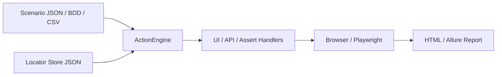

# Playwright Hybrid Framework - New User Guide

Welcome to the **Playwright Hybrid Framework**! This guide is designed for QA Engineers, Manual Testers, SDETs, and Business Analysts to get up and running quickly without needing deep TypeScript knowledge.

---

## Table of Contents
1. [Prerequisites & Installation](#1-prerequisites--installation)
2. [Understanding the Core Concept](#2-understanding-the-core-concept)
3. [Quick Start: Your First Test in 5 Minutes](#3-quick-start-your-first-test-in-5-minutes)
4. [Ways to Author Tests](#4-ways-to-author-tests)
   - [Option A: Direct JSON Scenarios](#option-a-direct-json-scenarios-recommended)
   - [Option B: BDD Gherkin (`.feature`)](#option-b-bdd-gherkin-feature)
   - [Option C: CSV Spreadsheets](#option-c-csv-spreadsheets)
   - [Option D: Traditional Coded Spec](#option-d-traditional-coded-spec)
5. [Managing Locators (`data/locators/`)](#5-managing-locators-datalocators)
6. [Dynamic Variables & Data-Driven Testing (DDT)](#6-dynamic-variables--data-driven-testing-ddt)
7. [Running Tests & Viewing Reports](#7-running-tests--viewing-reports)
8. [Advanced Features for Faster Testing](#8-advanced-features-for-faster-testing)
9. [CLI Commands Cheat Sheet](#9-cli-commands-cheat-sheet)
10. [Troubleshooting & FAQs](#10-troubleshooting--faqs)

---

## 1. Prerequisites & Installation

### Requirements
- **Node.js**: v18 or higher ([Download Node.js](https://nodejs.org/))
- **Visual Studio Code** (recommended) with the **Playwright Test for VSCode** extension.

### Step 1: Clone and Install Dependencies
Open your terminal in the project directory:
```bash
# Install NPM packages
npm install

# Install Playwright browser binaries
npx playwright install
```

### Step 2: Configure Environment Variables (Optional)
You can skip this step entirely. The framework needs no API key and no AI service to author, validate, or run tests.

The only optional setting is runtime locator healing:
```bash
cp .env.example .env
```
Then uncomment `OPENAI_API_KEY` in `.env` and set your key. Healing is also off per scenario file by default - a suite opts in with `"enableAutoHealing": true` in its `config` block.

*(With no key set, tests run normally and healing is skipped with a warning. A heal never edits your locator files: proposals are written to `reports/test-results/heal-report.json` for you to review.)*

---

## 2. Understanding the Core Concept

The framework separates test logic into three clean layers:
1. **Scenarios (`data/scenarios/`)**: The *What* (actions, steps, data).
2. **Locators (`data/locators/`)**: The *Where* (CSS/XPath selectors grouped by Page).
3. **Engine (`src/core/` & `src/handlers/`)**: The *How* (Playwright execution engine).



---

## 3. Quick Start: Your First Test in 5 Minutes

Let's automate a simple login test for **SauceDemo**.

### Step 1: Add Locators to `data/locators/my-app.json`
Create or open `data/locators/my-app.json`:
```json
{
  "LoginPage": {
    "usernameInput": "#user-name",
    "passwordInput": "#password",
    "loginButton": "#login-button"
  },
  "InventoryPage": {
    "title": ".title"
  }
}
```

### Step 2: Create Scenario in `data/scenarios/my-first-test.json`
Create a new file `data/scenarios/my-first-test.json`:
```json
{
  "$schema": "../../schema/scenario-schema.json",
  "config": {
    "locatorFile": "my-app.json"
  },
  "scenario": "My First Test Suite",
  "testCases": [
    {
      "testId": "TC_001",
      "testName": "User can log in successfully",
      "steps": [
        { "action": "goto", "data": "https://www.saucedemo.com/" },
        { "action": "fill", "page": "LoginPage", "element": "usernameInput", "data": "standard_user" },
        { "action": "fill", "page": "LoginPage", "element": "passwordInput", "data": "secret_sauce" },
        { "action": "click", "page": "LoginPage", "element": "loginButton" },
        { "action": "verify_visible", "page": "InventoryPage", "element": "title" },
        { "action": "verify_text", "page": "InventoryPage", "element": "title", "data": "Products" }
      ]
    }
  ]
}
```

### Step 3: Validate and Run
```bash
# Validate syntax and locators
npm run validate

# Run the test
npx playwright test tests/hybrid-json/ -g "TC_001"
```

---

## 4. Ways to Author Tests

### Option A: Direct JSON Scenarios (Recommended)
JSON scenarios support three lifecycle phases:
- **`preconditions`**: Setup steps (e.g. login, create data via API).
- **`steps`**: Core test flow and verifications.
- **`postconditions`**: Teardown steps (always executed even if test fails).

```json
{
  "testId": "TC_002",
  "testName": "Add Item to Cart",
  "preconditions": [
    { "action": "goto", "data": "https://www.saucedemo.com/" }
  ],
  "steps": [
    { "action": "click", "page": "InventoryPage", "element": "addToCartBtn" },
    { "action": "verify_text", "page": "Header", "element": "cartBadge", "data": "1" }
  ],
  "postconditions": [
    { "action": "click", "page": "InventoryPage", "element": "removeBtn" }
  ]
}
```

---

### Option B: BDD Gherkin (`.feature`)
Write feature files in `data/features/login.feature`:
```gherkin
Feature: User Authentication

Scenario: Successful Login
  Given I go to "https://www.saucedemo.com/"
  When I fill "standard_user" into "usernameInput" on "LoginPage"
  And I fill "secret_sauce" into "passwordInput" on "LoginPage"
  And I click "loginBtn" on "LoginPage"
  Then I verify "title" on "InventoryPage" has text "Products"
```

Compile it to JSON:
```bash
npm run compile-bdd
```
*Output generated in `data/scenarios/login-generated.json`.*

---

### Option C: CSV Spreadsheets
Create a CSV file in `data/csv/test-cases.csv`:
```csv
Phase,TestId,TestName,Action,Page,Element,Data
Setup,TC_01,Login Test,goto,,,https://www.saucedemo.com/
Step,TC_01,Login Test,fill,LoginPage,usernameInput,standard_user
Step,TC_01,Login Test,fill,LoginPage,passwordInput,secret_sauce
Step,TC_01,Login Test,click,LoginPage,loginBtn,
Step,TC_01,Login Test,verify_text,InventoryPage,title,Products
```

Compile it to JSON:
```bash
npm run csv2json -- test-cases.csv
```

---

### Option D: Traditional Coded Spec
If your test requires complex mathematical calculations, loops, or dynamic business rules, write standard Playwright code under `tests/hybrid-coded/`:
```typescript
import { test, expect } from '@playwright/test';
import locators from '../../data/locators/swag-lab.json';

test('Tax calculation check', async ({ page }) => {
  await page.goto('https://www.saucedemo.com/');
  await page.locator(locators.LoginPage.usernameInput).fill('standard_user');
  // Add complex assertions...
});
```

---

## 5. Managing Locators (`data/locators/`)

Locators are grouped by page names and element names:
```json
{
  "LoginPage": {
    "usernameInput": "#user-name",
    "passwordInput": "#password",
    "loginBtn": "input[type='submit']"
  }
}
```

### Auto-generating Locator Skeletons
If you created a scenario JSON first and don't want to type all locator keys manually:
```bash
npm run update-locators -- my-scenario.json
```
This automatically inspects your scenario and adds `"TODO_LOCATOR"` stubs to your locator file so you can resolve them with `npm run probe-locators` or `npx playwright codegen`!

---

## 6. Dynamic Variables & Data-Driven Testing (DDT)

### Built-in Dynamic Data Tokens
Use any of these tokens in the `"data"` or `"url"` fields:
- `{{TIMESTAMP}}`: Current timestamp in milliseconds.
- `{{RANDOM_EMAIL}}`: Random email (e.g. `qa_1718000000@test.com`).
- `{{RANDOM_STRING}}`: Random 6-character alphanumeric string.
- `{{RANDOM_PHONE}}`: Random 10-digit Vietnamese phone number.
- `{{UUID}}`: Standard v4 UUID.
- `{{DATE_TODAY}}`: Today's date (`YYYY-MM-DD`).
- `{{RANDOM_NUMBER}}`: Random 4-digit number.

### Capturing & Reusing Runtime Variables
You can extract values dynamically and reuse them in subsequent steps:
```json
{ "action": "store_text", "page": "OrderPage", "element": "orderNumber", "variable": "MY_ORDER_ID" },
{ "action": "fill", "page": "SearchPage", "element": "searchInput", "data": "{{MY_ORDER_ID}}" }
```

### Data-Driven Testing (DDT)
Run the exact same test with multiple rows of data using `dataTable`:
```json
{
  "testId": "DDT_LOGIN",
  "testName": "Login with multiple roles",
  "dataTable": [
    { "user": "standard_user", "pass": "secret_sauce", "expected": "Products" },
    { "user": "visual_user", "pass": "secret_sauce", "expected": "Products" }
  ],
  "steps": [
    { "action": "goto", "data": "https://www.saucedemo.com/" },
    { "action": "fill", "page": "LoginPage", "element": "usernameInput", "data": "{{user}}" },
    { "action": "fill", "page": "LoginPage", "element": "passwordInput", "data": "{{pass}}" },
    { "action": "click", "page": "LoginPage", "element": "loginBtn" },
    { "action": "verify_text", "page": "InventoryPage", "element": "title", "data": "{{expected}}" }
  ]
}
```

---

## 7. Running Tests & Viewing Reports

### Running Tests
```bash
# Run all JSON keyword tests
npm test

# Run interactive UI mode
npm run test-ui

# Run a specific scenario file or test name
npx playwright test tests/hybrid-json/ -g "TC_001"

# Run in headed mode (see the browser in action)
npx playwright test --headed
```

### Viewing Reports
All test outputs are written under `reports/`:
- Playwright HTML report: `reports/playwright-html/`
- Allure results and HTML report: `reports/allure-results/` and `reports/allure-html/`
- Failure traces, screenshots, and heal proposals: `reports/test-results/`

```bash
# Clean previous results and generate Allure report
npm run report

# Or serve live results
npm run allure:report

# Remove all generated reports
npm run clean
```

---

## 8. Advanced Features for Faster Testing

### A. Reusable Sub-Flows (`call_flow`)
Eliminate copy-pasting steps across multiple test cases by saving shared steps into `data/flows/my-flow.json`:
```json
{
  "action": "call_flow",
  "flow": "common-login",
  "params": {
    "username": "standard_user",
    "password": "secret_sauce"
  }
}
```

### B. Auth Session Caching (`save_storage_state`)
Save your login session once so other tests don't have to go through the login UI:
1. In your setup test, save the session:
   ```json
   { "action": "save_storage_state", "data": ".auth/user.json" }
   ```
2. In other test scenarios, skip login by adding `storageState` to config:
   ```json
   {
     "config": {
       "storageState": ".auth/user.json"
     }
   }
   ```

### C. Network & API Mocking (`mock_route`)
Fake backend API responses directly from JSON to test error states or offline scenarios:
```json
{
  "action": "mock_route",
  "url": "**/api/user/profile",
  "status": 500,
  "mockData": { "error": "Server error" }
}
```

### D. Visual Snapshot Testing (`verify_visual_snapshot`)
Compare full pages or element screenshots against golden baselines:
```json
{
  "action": "verify_visual_snapshot",
  "page": "InventoryPage",
  "element": "bikeLightAddBtn",
  "snapshotName": "bikelight-btn.png"
}
```

---

## 9. CLI Commands Cheat Sheet

| Command | Description |
| :--- | :--- |
| `npm run validate` | Lints all JSON scenarios against framework rules and locator files. |
| `npm test` | Cleans previous Allure results and executes all JSON test scenarios. |
| `npm run test:coded` | Executes hand-written Playwright specs in `tests/hybrid-coded/`. |
| `npm run test-ui` | Opens Playwright's interactive visual runner. |
| `npm run report` | Generates and opens the Allure HTML report in `reports/allure-html/`. |
| `npm run clean` | Removes the entire `reports/` directory. |
| `npm run compile-bdd` | Compiles `.feature` files in `data/features/` into JSON scenarios. |
| `npm run csv2json -- <file.csv>` | Converts CSV test cases from `data/csv/` to JSON scenarios. |
| `npm run update-locators -- <file.json>` | Auto-populates missing locator keys as `"TODO_LOCATOR"` in the locator JSON file. |
| `npm run probe-locators -- <config.json>` | Probes live DOM attributes and writes evidence to `reports/probe/`. |

---

## 10. Troubleshooting & FAQs

**Q: Why is my step failing with `Page not found in locators repository`?**
- Ensure the `page` name in your step matches the key in your locator JSON file (case-sensitive).

**Q: Can I combine API and UI in the same test?**
- Yes. Use `api_post` / `api_get` in `preconditions` to create test data, store the ID via `store_response`, and pass it to UI steps using `{{variable}}`.

**Q: How do I enable VS Code auto-completion for JSON scenarios?**
- Add `"$schema": "../../schema/scenario-schema.json"` at the top of your JSON file.
